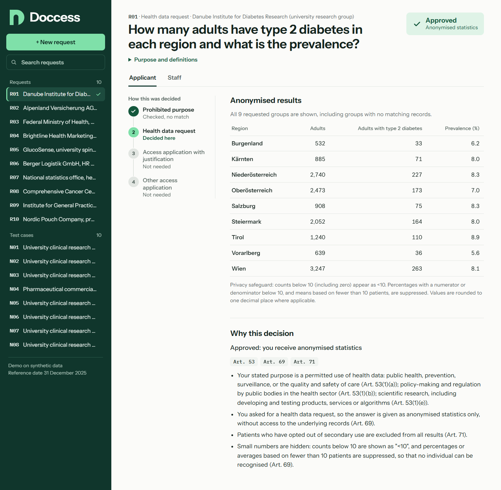
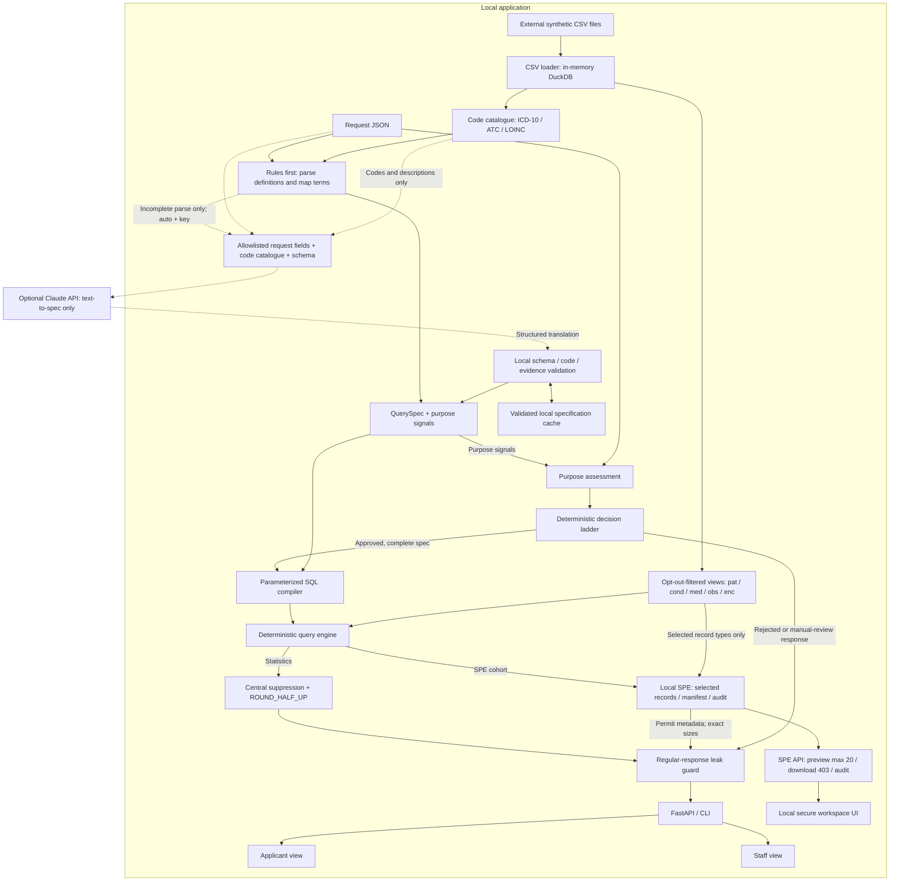

# Doccess

Doccess is a local hackathon demo for **Clinical AI, Track 3: European Health Data Space**. Submit a health-data request as JSON and follow it from purpose assessment to an explained decision, protected statistics or a local secure-processing workspace.

The demo uses **20,000 synthetic patients** from the separately supplied Track 3 dataset. It runs without an LLM. Applicant and Staff views explain the same result at different levels: applicants see the decision and next step; staff see the rule trace, terminology mapping, structured query, SQL, opt-out exclusions and disclosure notes.



The interface uses only local assets. Instrument Sans and IBM Plex Mono are self-hosted under the SIL Open Font License (`web/assets/fonts/`).

## Setup and start

Requires **Python >= 3.12**, tested on **3.14**. The frontend is plain HTML, CSS and JavaScript; it needs no separate build step.

Run commands from this repository or its worktree root. The original dataset is already supplied externally as `track3` beside the main repository:

```text
parent/
  hackathon-clinical-ai/
  track3/
    data/              # five original CSV files
    requests/          # R01-R10.json and expected.json
```

Keep those original files there: **do not copy them into this repository or clone the dataset again**. `TRACK3_DATA` must point to the `track3` folder containing both `data/` and `requests/`, rather than to `data/` itself. If unset, the app searches repository ancestors for `track3/requests/expected.json`; this also works from nested `.claude/worktrees/...` checkouts.

### Windows PowerShell

```powershell
python -m venv .venv
.\.venv\Scripts\python.exe -m pip install -e '.[dev,llm]'
$env:EHDS_LLM = 'off'
# Optional when ancestor discovery cannot find the external dataset:
# $env:TRACK3_DATA = 'C:\path\to\track3'
.\.venv\Scripts\python.exe -m ehds_desk serve
```

### Unix / macOS

```bash
python3 -m venv .venv
.venv/bin/python -m pip install -e '.[dev,llm]'
export EHDS_LLM=off
# Optional when ancestor discovery cannot find the external dataset:
# export TRACK3_DATA=/path/to/track3
.venv/bin/python -m ehds_desk serve
```

Open [http://127.0.0.1:8000](http://127.0.0.1:8000). To choose another port, append `--port 8001`. The equivalent command with the virtual environment activated is `python -m ehds_desk serve`.

### CLI and verification

Use the virtual environment's Python for these commands (`.\.venv\Scripts\python.exe` on Windows or `.venv/bin/python` on Unix), or activate the environment first:

```bash
python -m ehds_desk decide requests/extra/N01.json
python -m ehds_desk decide requests/extra/N01.json --staff
python -m pytest -q
python eval/reference.py
python eval/run_eval.py
```

`decide` prints Applicant JSON; `--staff` prints the full Applicant and Staff result. An original request can be passed by its external path, for example `<track3>/requests/R01.json`. The reference script also accepts `--data <track3>`.

Install both extras as shown above: `dev` supplies pytest/httpx, and `llm` supplies the optional Anthropic SDK needed by the offline SDK tests. These tests use fake clients and do not require a key. The evaluation explicitly disables the LLM, sets the key to `None`, uses an isolated runtime directory and rewrites [eval/results.md](eval/results.md). The reference and evaluation scripts do not load `.env`; export `TRACK3_DATA` in the shell when ancestor discovery is unavailable.

### Configuration and optional Claude

The app reads environment variables and an optional local `.env`; see [.env.example](.env.example). `.env` is ignored by Git. Keep API keys only in that local file or the environment, never in code, request JSON, URLs or commits. Use synthetic request text only.

| Setting | Meaning |
|---|---|
| `TRACK3_DATA` | External folder containing `data/` and `requests/`; otherwise ancestor discovery |
| `EHDS_VAR_DIR` | Runtime root; defaults to this checkout's `var/` (SPE copies, audit logs and cache) |
| `EHDS_LLM` | `off` for offline rules only; `auto` (default) permits optional translation when parsing is incomplete and a key is configured |
| `ANTHROPIC_API_KEY` | Optional Claude API key; unnecessary for the offline demo and evaluation |
| `EHDS_LLM_MODEL` | Optional model override; default `claude-opus-5-5` |

A complete rule parse never invokes Claude, even in `auto` mode. For incomplete requests, the official `anthropic` SDK can translate allowlisted request fields into a validated specification. There is **no live-Claude evidence** in the reported evaluation. Cached translations are reproducible for the same canonical payload, model and prompt version; no sampling parameter is sent. A fresh, uncached model call is not guaranteed to produce the same translation.

## Demo walkthrough

Select a request in the Inbox to assess it. Use **+ New request** to paste another synthetic JSON request; no request-specific SQL is entered by hand.

1. **R01:** Show the Applicant decision, article references and result groups. Switch to **Staff** for the purpose evidence, rule ladder, code mapping, QuerySpec, generated SQL, opt-out exclusions and suppression notes.
2. **R05:** Show `APPROVE_SPE` and the exact cohort of **1,152 patients**. Click **Open secure workspace** and **Download** for a listed table. **Preview** is available for local inspection; keep patient rows closed in screenshots and the submission video. The UI shows **Download blocked · HTTP 403** and the audit log gains a `download_blocked` event.
3. **R06:** Show rejection under Art. 54 for the employment-related purpose.
4. **R09:** Show an access application falling back to statistics under Arts. 53, 66 and 69 because it does not justify record-level access.
5. Optionally show **N01** (inpatient stays by hospital, with a primary-diagnosis filter) or **N03** (plain-language asthma and medication mapping without codes).

### Suggested 120-second video

| Time | Screen and narration |
|---|---|
| 0-15 s | Introduce the Access Body workflow and the synthetic, local dataset. |
| 15-40 s | R01 Applicant: clear decision, articles, groups and suppression. Staff: evidence, terminology and generated SQL. |
| 40-75 s | R05: 1,152 patients, permitted table counts, blocked download and visible audit event; keep row previews closed. |
| 75-90 s | R06: prohibited purpose takes precedence. R09: statistics fallback. |
| 90-105 s | N01 or N03: a new request with generated queries or code-free terminology. |
| 105-120 s | Show the evaluation table; state offline measurement and local-demo limits. |

## Architecture and data flow



The row-level database stays on the local execution path. The optional SDK payload contains only `requested_as`, `requested_format`, `purpose`, `question`, `definitions`, code/description pairs and the translation schema. Applicant identity, arbitrary extra JSON fields, patient rows, query results and terminology row counts are not included in that payload. Model output cannot supply SQL or choose the access decision. Local checks validate the schema, code systems and purpose evidence; code availability is checked against the local catalogue.

The main interfaces are Pydantic v2 models: `AccessRequest` describes the input; `QuerySpec` describes cohort criteria, grouping, metrics and requested record types; `PurposeAssessment` carries cited evidence; `Decision` carries the outcome, articles and trace. `RawCount`, `RawPercent` and `RawMean` retain the counts needed for disclosure checks before `ProcessResult` assembles Applicant and Staff views.

| Components | Responsibility |
|---|---|
| `config.py`, `models.py`, `law.py` | Settings, validated contracts and the local article catalogue |
| `parsing/`, `terminology.py` | Rules first, clinical term mapping, optional Claude translation and validated cache |
| `decision.py`, `pipeline.py` | Purpose assessment, fixed decision order, computation gating and response assembly |
| `data.py`, `compiler.py`, `engine.py` | Local CSV loading, filtered views, parameterized queries and deterministic calculation |
| `disclosure.py`, `spe.py` | Statistical suppression and leak checks, or scoped SPE copies and audit events |
| `api.py`, `__main__.py`, `web/` | FastAPI/Uvicorn service, JSON CLI and browser UI |

No hosted database or model service is required for the core demo. Runtime files remain under `EHDS_VAR_DIR`; the standard `var/` location, `.env`, CSVs and DuckDB files are ignored by Git.

## Decision rules and data protection

The demo applies this fixed order to recognized purpose evidence; these rules implement the challenge and do not replace a legal review:

| Priority | Condition | Result and articles |
|---|---|---|
| 1 | Prohibited purpose | `REJECT`, Art. 54 |
| 2 | Health data request | `APPROVE_STATISTICAL`, Arts. 53, 69 |
| 3 | Access application with recognized justification that statistics are insufficient | `APPROVE_SPE`, Arts. 53, 66, 68, 73 |
| 4 | Other access application | `APPROVE_STATISTICAL`, Arts. 53, 66, 69 |

Art. 71 is added for opt-out handling on approvals. Purpose evidence and each ladder step are visible to Staff. A legal outcome alone does not release data: incomplete parsing leads to **Manual review required**, with no statistics or SPE provisioned.

- **Opt-out:** `pat`, `cond`, `med`, `obs` and `enc` exclude opted-out patients from numerators, denominators, means and SPE cohorts. The `_all` views support the internal comparison for Staff's opt-out exclusion count; that displayed count also passes suppression.
- **Primary suppression:** every requested group appears, including empty groups. Counts below **10**, including **0**, become `<10`. Percentages become `suppressed` if either numerator or denominator is below 10. Means become `suppressed` if fewer than 10 patients contribute. Percentages and means use `Decimal` and **ROUND_HALF_UP to one decimal place**.
- **Query semantics:** the reference date is **2025-12-31**; age is `2025 - birth year`. Medication is active when its start date is on or before that date and its end date is empty or on or after it. Observation calculations use the latest measurement per patient. Encounter requests count **stays**, and filter `primary_icd10` only when a main/primary diagnosis is explicitly requested.
- **Output checks:** statistical tables pass centralized disclosure and a leak guard; regular Applicant and Staff responses are checked for patient identifiers. SQL values are parameters and identifiers come from controlled choices. Patient rows are available only through the explicit local SPE preview.
- **SPE scope:** a separate local DuckDB file contains the selected consented cohort and requested record types, with any requested observation-code restriction. Original patient IDs remain unchanged inside that copy. Preview is limited to **20 rows per call**. Exact SPE cohort/table sizes are allowed by the challenge and are exempt from statistical small-cell suppression. Download attempts on an existing permit return **HTTP 403** and create an audit event.

## Measured results

Recorded evaluation in [eval/results.md](eval/results.md) on **2026-10-30**, measured against the final working tree before its closing commit:

| Metric | Original R01-R10 | Extra N01-N10 | Target |
|---|---:|---:|---|
| Correct decisions | 10/10 | 10/10 | All decisions and required articles |
| Correct numbers | 6/6 | 8/8 | All approved requests |
| Privacy leaks (all runs) | 0 | 0 | 0 |
| Consistency (Applicant JSON) | 10/10 | 10/10 | Identical over three runs |
| Time to answer (slowest HTTP run) | 0.909 s | 0.246 s | < 60 s |

Explicitly unresolved record, measurement, cohort or grouping scopes require **mandatory Staff review**. Optional LLM translation and cached output cannot override that gate. Recognized postfix measurement forms, such as observations for HbA1c only, retain their code restriction.

These are **60 actual FastAPI TestClient POSTs**: three complete runs of each original and extra request. Decisions, numbers and privacy checks cover all runs. Consistency compares the full Applicant JSON; Staff timing fields and SPE audit events are outside that comparison. Timing is POST-to-response, including SPE provisioning, with the service initialized before measurement.

The measurement is local and offline on the supplied synthetic data: **no live LLM, real network latency, authentication or production load test**. `EHDS_LLM` is explicitly `off` and the evaluation API key is `None`. Zero detected leaks describes the implemented checks on these cases, not a general anonymity guarantee.

An independent standard-library CSV reference matches **14/14** numerical cases (six original and eight extra), without importing the application, DuckDB or Pydantic. The evaluation also checks opt-out membership, the SPE schema, the entire selected cohort and copied records **including multiplicity**, rather than relying only on counts. Ten extra requests cover main diagnosis, hospital grouping, code-free terminology, prohibited-purpose boundaries, cessation research, a different SPE record type, many small cells and access fallback.

Additional recorded verification: **714 pytest tests passed**, and **133 real Edge browser checks** covered Applicant/Staff, both SPEs, desktop and a **375 px** viewport. See [STATUS](docs/STATUS.md) and [WORKLOG](docs/WORKLOG.md) for the runs. The [security review](docs/SECURITY_REVIEW.md) records the static checks, the subsequently closed scope findings and the local demo limits.

## Known limits

- This is a **local synthetic-data demo** without real authentication, role enforcement or a production-hardened SPE. Applicant and Staff tabs are presentation views, not authorization boundaries. Previewed records and local files can be copied in a real browser/operating-system environment; blocking the download endpoint does not prevent that.
- Disclosure implements primary small-cell suppression. **Secondary suppression, differencing protection and protection across repeated queries are absent**; the output is not a claim of absolute anonymity or legal compliance.
- The English rule parser intentionally accepts a limited grammar and refers unsupported requests to manual review. Purpose regexes also have known negation cases: **“No, we will use the data for advertising.” can evade the Art. 54 match**. Such cases require a separate Staff purpose check; a complete parse does not trigger an LLM check or an automatic manual-review gate for every missed purpose.
- The optional Claude path has offline validation/fake-client tests, **no reported live-call proof**. It has one **30-second response budget**, including at most one schema correction, with no SDK retries. A supplied client thread can ignore its timeout and continue running; a late result is neither returned nor cached. A timeout retains the rule result and reports the need for manual review.
- The workspace offers record preview and audit visibility. **Model-training and reviewed-result-export tools are not implemented.** Federation, OMOP/FHIR conversion, fees, statutory deadlines and a complete legal assessment are outside this demo.

## Further reading

[Challenge](docs/CHALLENGE.md) · [Law notes](docs/LAW.md) · [Goals](docs/GOALS.md) · [Architecture decisions](docs/DECISIONS.md) · [Project instructions](CLAUDE.md) · [Design](docs/superpowers/specs/2026-10-29-ehds-access-desk-design.md) · [Implementation plan](docs/superpowers/plans/2026-10-29-ehds-access-desk.md)
