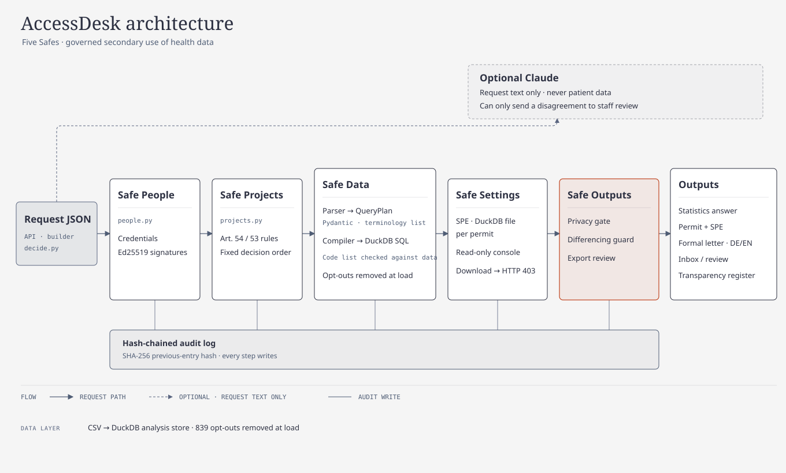

# AccessDesk 2: an automated Health Data Access Body for the EHDS

Track 3 (European Health Data Space) of the Healthcare Hackathon by AIM Austria.

AccessDesk 2 decides health data requests under Regulation (EU) 2025/327 the way an access body would, in well under a second per request. It takes a request as JSON and does the following:

1. checks **who is asking**, using signed eID, register, mandate and licence credentials;
2. decides `REJECT`, `APPROVE_STATISTICAL` or `APPROVE_SPE` in the fixed order of the brief and cites the articles;
3. translates the plain-English definitions into ICD-10, ATC and LOINC codes, a typed query plan and SQL;
4. computes the statistics, or builds a secure processing environment (SPE) for the selected patients only;
5. releases numbers only through a privacy gate (small-cell rule, opt-outs, rounding, no totals, a differencing check);
6. issues a formal, bilingual decision letter, lists every case in a staff inbox and publishes every decision in a public transparency register.

The product follows the **Five Safes** framework for trusted research environments. Every request gets a Five Safes overview, and each safe is its own module.

## Results on the 10 test requests

| Metric | Result | Target |
|---|---|---|
| Correct decisions (decision + articles) | **10 / 10** | 10 / 10 |
| Correct numbers (approved requests) | **6 / 6** | 6 / 6 |
| Privacy leaks | **0** | 0 |
| Consistency (same result in 3 runs) | **10 / 10** | 10 / 10 |
| Time to answer (slowest of the 10) | **≈ 75 ms** | < 60 s |

Reproduce with `python evaluate.py`. The metrics are measured on the rules alone, with the AI switched off, because the AI never decides.

Beyond the official metric, every request is also checked:

- **Strict check against an independent pandas oracle, 29 / 29.** `tests/oracle/oracle.py` recomputes every value from the CSVs without any app code. It first reproduces the official `expected.json` exactly. The check then requires exactly the requested groups, every value in report order, the cohort size, the SPE contents and the cohort funnel. It covers the 10 official requests, 4 demo cases and 15 own jury-style requests:
  - inpatient stays filtered by `primary_icd10`
  - grouping by hospital (`data_holder`), by two dimensions and by year
  - "HbA1c above 8"
  - terms without a code
  - disguised prohibited purposes (brand "awareness", credit limits, choosing staff)
  - access applications with and without a justification
  - almost all cells below 10
- **Same numbers as the original prototype:** decision, articles, delivery status and every released value match on all 14 official and demo requests (`tests/test_golden_prototype.py`).

Run everything with `python evaluate.py --suite all`.

## Run it (Windows PowerShell; macOS and Linux work the same)

You need Python 3.10 or newer. Nothing else: the built web app is committed.

```powershell
# 1. Put this repository and the Track 3 data side by side:
#    ...\accessdesk2\            this repository
#    ...\TRACK-3-ehds\data\      patients.csv, conditions.csv, ... (git clone https://github.com/AIM-Austria/TRACK-3-ehds.git)
cd accessdesk2
python start.py              # or: python3 start.py
```

`start.py` uses the current Python if FastAPI, Uvicorn, DuckDB and Pydantic are installed. Otherwise it creates `.venv` and installs `requirements.txt`; the internet is needed only for this first run. It then picks port 8000, or the next free one, and opens the browser. Use `--data PATH` if the data is somewhere else and `--no-browser` to skip the browser. Stop it with Ctrl+C.

More commands:

```powershell
python evaluate.py                                   # the five metrics on R01-R10 (3 runs each)
python evaluate.py --suite all                       # + strict pandas-oracle check of all 29 requests
python decide.py ..\TRACK-3-ehds\requests\R01.json   # one request in, decision and answer out (JSON)
Invoke-RestMethod -Method Post -Uri http://127.0.0.1:8000/api/decide `
  -ContentType "application/json" -InFile ..\TRACK-3-ehds\requests\R01.json   # same, over HTTP
.venv\Scripts\python -m pip install -r requirements-dev.txt
.venv\Scripts\python -m pytest -q                    # backend tests
cd web; npm ci; npm run build; npx playwright test   # UI tests (uses the installed Chrome)
```

The interactive API documentation is at `/docs`. New requests can be sent as JSON to `POST /api/decide` (stateless), submitted through `POST /api/submit`, or pasted into the request builder in the UI.

**Optional AI:**

1. Run `.venv\Scripts\python -m pip install -r requirements-ai.txt`.
2. Set `ANTHROPIC_API_KEY` in the environment or in a local `.env` file. `.env` is git-ignored.

Without a key, everything works except the AI draft and the AI second opinion, and the UI says so.

## Architecture



```
request.json ─► FastAPI (accessdesk/api.py) ─► pipeline.py: one request through the Five Safes
                                                  │
  Safe People    safes/people.py      eID, register, mandate, Medical Chamber licence (Ed25519) + plausibility
  Safe Projects  safes/projects.py    Art. 54 / Art. 53 features with evidence → fixed decision order → articles
  Safe Data      plan/parser.py       definitions → QueryPlan (Pydantic: a typed, validated query language)
                 plan/terminology.py  plain-English term → ICD-10 / ATC / LOINC (only codes present in the data)
                 plan/compiler.py     QueryPlan → DuckDB SQL (whitelists, opt-out filter always added)
                 safes/data.py        mappings with row counts, cohort funnel, data minimisation
  Safe Settings  safes/settings.py    SPE: one DuckDB file per data permit, read-only SQL console, no download
  Safe Outputs   safes/outputs.py     privacy gate (the only function that releases numbers), export checks,
                                      differencing guard
  audit.py     tamper-evident audit log: each entry carries the SHA-256 of the previous one
  cases.py     inbox, statuses, staff review with a mandatory reason
  letter.py    formal decision letter (DE/EN) from reviewed text blocks
  ai.py        optional Claude helper (prompts and schemas in ai_spec.py)
web/           React + TypeScript + IBM Carbon, built into web/dist and served by FastAPI
```

### How one request flows

1. **Safe People.** The applicant's credentials are verified: eID (ID Austria or EUDI Wallet), the organisation in a register, the mandate, and, if they claim to be a physician, a Medical Chamber licence. A forged credential (demo D03) fails the Ed25519 check and the result is held. If the organisation does not fit the purpose, for example an insurer or a bank asking with a harmless-sounding purpose, the case is held for review.
2. **Safe Projects.** Rules extract prohibited (Art. 54) and allowed (Art. 53) purposes and keep the exact phrases as evidence. The brief's order applies:
   1. prohibited → `REJECT [54]`
   2. health data request → `APPROVE_STATISTICAL [53, 69]`
   3. access application that explains why statistics are not enough → `APPROVE_SPE [53, 66, 68, 73]`
   4. any other access application → `APPROVE_STATISTICAL [53, 66, 69]`

   A rejected request never touches the data.
3. **Safe Data.** The parser reads the definitions sentence by sentence: age rules and bands, sex, ICD-10/ATC prefixes, "use the latest …", thresholds such as "above 8", the active-medication rule, stays filtered by main diagnosis, length of stay, ratios, cohorts, "how many of them" and "that share". It outputs a `QueryPlan`: Pydantic models that validate every code, comparator, band and value. The compiler turns the plan into one SQL statement. Codes are checked against strict patterns a second time, so neither a request nor the AI can inject SQL. Opted-out patients (839) are removed when the CSVs are loaded and filtered again in every query.
4. **Safe Settings.** For statistics, the query runs inside the access body and only aggregates leave. For an SPE, the cohort (original pseudonyms) and only the record types the request names are copied into a separate DuckDB file. For R05 that means conditions, medications and only the HbA1c observations: 1,152 people.
   - The applicant works in a SQL console that opens this file read-only, with external file access disabled, extensions off and the configuration locked.
   - Only one SELECT/WITH statement is allowed, and it is stopped after 5 seconds.
   - Raw download returns HTTP 403 and is logged.
5. **Safe Outputs.** The privacy gate applies the small-cell rule:
   - every group is shown;
   - counts below 10 become "<10";
   - a share with numerator or denominator below 10, or a mean of fewer than 10 people, becomes "suppressed";
   - values are rounded half up with `Decimal`;
   - there are no total rows.

   The **differencing guard** then compares every released cell with all cells released earlier to the same applicant, using bitmaps of the people behind each cell. If two answers differ by 1 to 9 people, the new cell is suppressed with an explanation. Demo D05 is R01 again, but for adults aged 19+. In Vorarlberg the two answers would differ by eight 18-year-olds, so that cell is hidden. Exports from an SPE pass an automatic check (identifiers, counts below 10, record-level size) and then need staff approval (Art. 73(2)).
6. **Delivery.** The case lands in the staff inbox as decided automatically, review needed, identity pending, released or refused after review. Staff review with a mandatory reason, written to the hash-chained audit log. The applicant sees the decision in plain language, the result with map or bars (hidden values hatched), and a formal letter. The public **transparency register** lists every request on receipt and every decision with its justification. This is required by Art. 57(1)(j)(ii)–(iii) and Art. 58(1)(f). The register contains no results and no personal data.

### Design decisions

- **Rules decide, AI assists.** Rules give the same answer every run and show their evidence. The AI is never in the decision path.
- **One typed query language.** Applicants, templates and the AI all produce the same thing, definitions in plain English. One parser turns them into one validated `QueryPlan`, and one compiler turns that into SQL. There is no per-request code anywhere in the app.
- **DuckDB** instead of SQLite, because the SPE needs a lockable, read-only file per permit ([ADR 0001](docs/adr/0001-duckdb-instead-of-sqlite.md)).
- **Central processing.** Federation was designed but not built ([ADR 0002](docs/adr/0002-central-processing-not-federated.md)). The data shows it would give identical numbers: 0 of 47,706 stays cross hospitals, and every measure can be summed over nodes.
- **UI:** IBM Carbon with IBM Plex, light and dark, dense tables instead of tiles, status colours only with meaning and always with an icon and text, keyboard shortcuts in the inbox (j/k/Enter, `/`), WCAG 2.1 AA checked with axe, DE/EN complete. The rules are in [docs/design.md](docs/design.md).
- **Legal texts** were checked against the official EN and DE text of the Regulation ([docs/legal/compliance-check.md](docs/legal/compliance-check.md)). The letter uses reviewed text blocks, and the remedy section is a marked placeholder.

## Models and services

| What | Used for | Notes |
|---|---|---|
| DuckDB 1.5.6 | Analysis store, one database file per SPE | In-process, no server |
| FastAPI + Uvicorn | API and serving the web app | Local only |
| React 19, TypeScript, Vite, IBM Carbon, d3-geo/d3-scale | Web app | Built into `web/dist`; no external requests at runtime |
| Ed25519 (pure Python, RFC 8032) | Signature checks of credentials | `cryptography` is used if installed |
| Anthropic Claude (`claude-opus-5-5`), optional | 1) draft the formal definitions from a free-text question (DE/EN), 2) a second opinion on the purpose, 3) map a term to codes, 4) a plain-language explanation | Structured JSON outputs. It sees request text and the code list only, never patient data. The term → code mapping can only choose from an enum of codes in the data, every answer is cached per input, and a disagreement only sends the case to staff review |
| Natural Earth admin-1 boundaries | Austria map | Public domain, bundled (`web/src/assets/SOURCES.md`) |

The eID, the business register, the ROR, the e-mandate service and the Medical Chamber are **simulated** (`demo/registry.json`). The signatures are real.

## What works and what does not

Works:

- All 10 test requests and the demo cases end to end, in the UI and over the API.
- New requests in the same style: other conditions, drugs and measurements; grouping by region, age band, hospital, sex or year, and by two dimensions; stays by main diagnosis; length of stay; thresholds; terms without a code; access applications with and without a justification.
- Staff inbox, Five Safes case view, review with audit trail, decision letter (print to PDF), transparency register, SPE workspace with blocked download and reviewed exports, differencing guard, audit-chain verification and a live evaluation page.

Limits:

- **Parser coverage.** The parser understands the sentence patterns of the brief and close variants. Anything else produces a visible warning, and the case goes to "review needed".
- **Purpose rules** are keyword patterns with evidence. A cleverly disguised purpose may need the plausibility check, the AI second opinion or staff.
- **Simulated identity.** Identity services are simulated. Federation is not implemented. Deadlines, fees and cross-border access are not modelled.
- **AI is optional.** All metrics come from the rules. Without an API key, the AI draft and the second opinion are off.
- **Rounding can be probed.** The builder's live pre-check shows cohort sizes rounded to 10. Many prechecks with small variations could narrow a number down; a real deployment would rate-limit them or run the differencing guard on them too.

## Repository layout

```
accessdesk/        backend (Five Safes modules, plan/, api.py, cases.py, letter.py, ai.py, evaluation.py)
web/               frontend source; web/dist is the committed build
demo/              demo requests D01-D05, builder templates, simulated credential registry
tests/             pytest: unit, API, golden (prototype), oracle (pandas); tests/oracle/requests T01-T15
docs/              plan, design rules, ADRs, legal check, screenshots
start.py           one command to run the app
evaluate.py        the metrics
decide.py          one request from the command line
```

The synthetic data is not part of this repository. All data is synthetic, as the track rules require.
