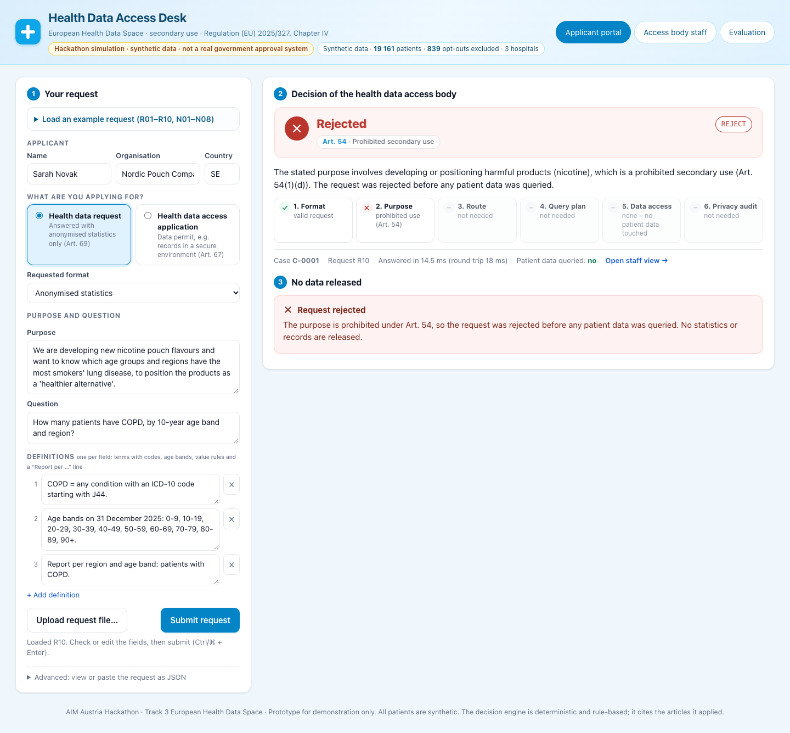
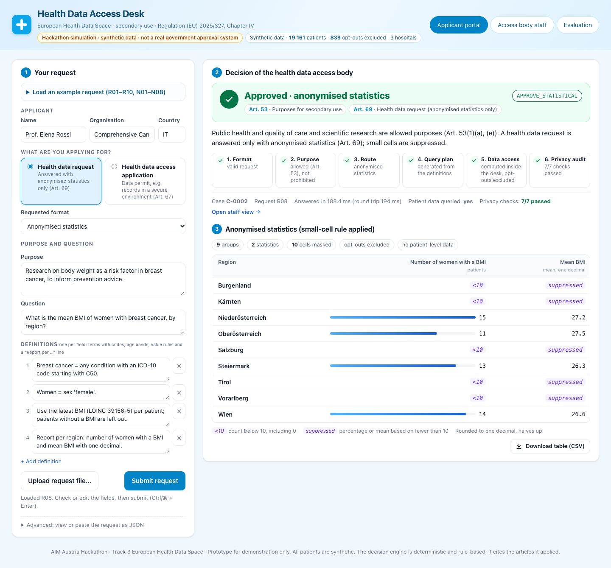
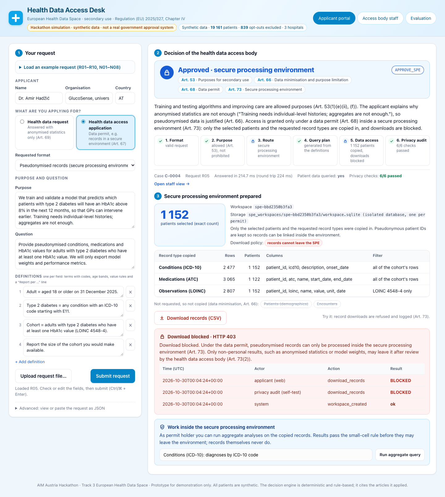
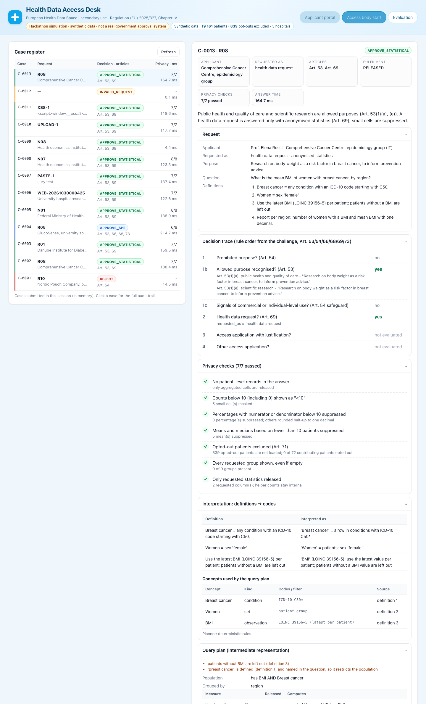

# Health Data Access Desk (EHDS, Track 3)

> **Hackathon simulation.** All patients are synthetic. This is **not** a real government approval system.

A browser-based desk for a Health Data Access Body under the European Health Data Space Regulation
(EU) 2025/327, Chapter IV. An applicant submits a request in the challenge JSON format. The desk then:

1. decides `REJECT`, `APPROVE_STATISTICAL` or `APPROVE_SPE` and cites the articles,
2. for statistics, generates a query plan from the request's definitions and computes the numbers with
   the small-cell rule,
3. for a secure processing environment (SPE), copies only the selected patients' requested records into an
   isolated workspace, reports the exact cohort size and blocks downloads,
4. shows the decision, the reason and every privacy check to the applicant and to staff.

The challenge description is in [CHALLENGE.md](CHALLENGE.md). `data/` and `requests/` are copied unchanged
from `AIM-Austria/TRACK-3-ehds@ba0ff54`. A test verifies their SHA-256 checksums against
[challenge.sha256](challenge.sha256).

## Quick start (one command)

Requires Python 3.9 or newer. There are no packages to install. Tested with 3.9.6, 3.12.12 and 3.14.7.

```bash
cd track3-ehds
python3 -m desk
```

Then open **http://127.0.0.1:8000**. Use `python3 -m desk serve --port 8080` to pick another port.

| Task | Command |
|---|---|
| Start the web app | `python3 -m desk` |
| Evaluate R01–R10 three times against `expected.json` | `python3 -m desk evaluate` (add `--save` to write `reports/`) |
| Same evaluation through the running web server | `python3 -m desk evaluate --url http://127.0.0.1:8000` |
| Unit and integration tests (90) | `python3 -m unittest discover -s tests -t .` |
| Browser end-to-end test (23 checks, needs Node ≥ 22 and Chrome) | `node tests/e2e/browser_flow.mjs http://127.0.0.1:8000` |
| Process one file on the command line | `python3 -m desk run new_requests/N01.json [--staff]` |

### Running it online

Use a host that runs a long-lived Python process with a writable disk, e.g. Render, Railway, Fly.io or a
small VM.
- Start command: `cd track3-ehds && python3 -m desk`.
- If the platform sets `$PORT`, the desk binds to `0.0.0.0:$PORT` by itself. Otherwise set `DESK_HOST` and
  `DESK_PORT`.
- No build step and no dependencies are needed.
- Serverless platforms such as Vercel functions are not a good fit: the desk keeps the data in memory and
  writes SPE workspaces and the case register to disk.

## Results on the 10 supplied requests

Actual output of `python3 -m desk evaluate --save` ([reports/evaluation.txt](reports/evaluation.txt)):

```
req  decision             articles       dec  numbers  leaks  consistent   max ms
----------------------------------------------------------------------------------
R01  APPROVE_STATISTICAL  53,69          OK   OK       0      yes           187.7
R02  REJECT               54             OK   -        0      yes             1.1
R03  APPROVE_STATISTICAL  53,69          OK   OK       0      yes           137.2
R04  REJECT               54             OK   -        0      yes             1.0
R05  APPROVE_SPE          53,66,68,73    OK   OK       0      yes           160.7
R06  REJECT               54             OK   -        0      yes             1.0
R07  APPROVE_STATISTICAL  53,69          OK   OK       0      yes            97.6
R08  APPROVE_STATISTICAL  53,69          OK   OK       0      yes           159.1
R09  APPROVE_STATISTICAL  53,66,69       OK   OK       0      yes           219.1
R10  REJECT               54             OK   -        0      yes             1.6
```

| Metric | Result | Target |
|---|---|---|
| Correct decisions (decision and articles) | **10 / 10** | 10 of 10 |
| Correct numbers (approved requests: 5 statistical answers plus the R05 cohort size) | **6 / 6** | 6 of 6 |
| Privacy leaks | **0** | 0 |
| Consistency across 3 runs (fresh data load per run) | **10 / 10** | 10 of 10 |
| Slowest answer, submission to answer | **0.22 s** (R09; 0.24 s over HTTP) | under 60 s |

The data load at startup takes about 1.1 s. `expected.json` is read only by `desk/evaluate.py` and the tests,
and only after the answers have been produced. No runtime code path reads it.

## What the applicant and staff see

| Applicant: R10 rejected (Art. 54) | Applicant: R08 statistics with `<10` / `suppressed` |
|---|---|
|  |  |
| **Applicant: R05 SPE, exact cohort, blocked download** | **Staff: decision trace, privacy checks, plan, SQL** |
|  |  |

- **Applicant portal:** the applicant fills in a form, never raw JSON. The form asks for:
  - name, organisation and country;
  - request type and format;
  - purpose and question;
  - one field per definition.

  The desk builds and stores the request in the challenge JSON format behind the scenes. Other ways in:
  - *Upload request file* fills the form from a JSON file;
  - *Load an example* fills it with R01–R10 or N01–N08;
  - a collapsed *Advanced* panel shows or accepts raw JSON (for the jury).

  Ctrl/⌘ + Enter submits.
- **Decision:** the banner shows an icon, the cited articles (hover for a one-line summary of each article),
  a plain-language reason, the answer time, whether patient data was queried and the number of privacy
  checks passed.
- **Processing steps:** a six-step strip shows where the request went: format → purpose (Art. 54/53) →
  route → query plan → data access → privacy audit. A rejection visibly stops at the purpose check, with
  no data access.
- **Statistics:** every requested group is listed, even if empty. Small cells are marked, released numbers
  get inline bars, and a summary shows how many cells were masked. The anonymised table can be downloaded
  as CSV, in deliberate contrast to the blocked SPE download.
- **SPE:** shows the exact cohort size, the record types copied in (with row counts, columns and filters)
  and the record types that were left out (data minimisation). A *Download records* button returns
  HTTP 403, and the panel then shows the workspace access log with the blocked attempt.
- **Assumptions are visible.** If the desk used a default (for example "adults" without a definition),
  the answer says so.
- **Mobile:** the layout works down to phone width (390 px).
- **Staff view:** a case register, the full request, the decision trace (which rule fired, with quoted
  evidence), how each definition was interpreted (term → ICD-10/ATC/LOINC and its source), the IR, the
  generated parameterized SQL, the privacy checks and the SPE access log.
- **Evaluation tab:** runs the harness (30 submissions) and shows the five metrics.

## Architecture

```
 Browser UI (web/: index.html, app.js, styles.css; no build step, strict CSP)
        │ JSON over HTTP, 127.0.0.1
        ▼
 desk/server.py  (Python stdlib http.server)  ──►  desk/pipeline.py  Desk.process(request)
   1  request_schema.py   validate the JSON format; reject malformed input with clear errors
   2  policy.py           decision + articles, in the README order (54 → 69 → 66/68/73 → 66/69)
                          REJECT / NO_DECISION stop here: 0 database queries
   3  parser.py           definitions + question → intermediate representation (IR)
      vocabulary.py       plain English → ICD-10 / ATC / LOINC / encounter types; reference groups
      llm.py (optional)   validated LLM fallback, only if configured and only when the rules fail
   4  ir.py               IR validator (codes, references, group sizes, no free-form SQL)
   5  executor.py         IR → parameterized SQL (one feature query per request) → exact aggregation
      disclosure.py       <10, suppressed percentages and means, half-up rounding on exact fractions
   6  spe.py              one isolated SQLite database per data permit; downloads → HTTP 403 + log
   7  audit.py            independent privacy checks on the released answer; any failure withholds it
        ▼
 datastore.py  in-memory SQLite built from data/*.csv; opted-out patients are never loaded
```

**Design choices**

- **Standard library only:** `sqlite3`, `http.server`, `fractions`, `csv`. One command starts the app on
  any machine with Python, with no dependency drift.
- **One central database** (single node), not federated queries. Data holders stay visible through the
  `data_holder` column, so results can be grouped by hospital.
- **Rules first, LLM optional.** Every decision and every number on the supplied requests comes from
  deterministic code, so results are reproducible and explainable.

### Decision engine ([desk/policy.py](desk/policy.py))

Uses only `purpose`, `question`, `definitions`, `requested_as` and `requested_format`. The ID, the
applicant name and the organisation are never inspected. A test renames them and checks that the result
does not change.

1. **Prohibited purpose → `REJECT`, Art. 54.** The patterns follow Art. 54(1):
   - (a) decisions about identified individuals or re-identification, e.g. matching with an employee or
     customer list,
   - (b) insurance premiums or exclusion, credit and loans, job offers and employment decisions,
   - (c) advertising and marketing,
   - (d) developing harmful products such as tobacco, nicotine, alcohol, weapons or addictive products.

   Benign phrases such as *marketing authorisation*, *post-marketing surveillance*, *smoking cessation* and
   *tobacco control* are removed first, so they do not trigger a rejection.
2. **Health data request → `APPROVE_STATISTICAL`, Art. 53 + 69.**
3. **Access application that explains why statistics are not enough → `APPROVE_SPE`, Art. 53, 66, 68,
   73.** The explanation must be explicit, e.g. *"aggregates are not enough"* or *"needs individual-level
   histories"*. Negated forms (*"we do not need individual-level data"*) do not count.
4. **Any other access application → `APPROVE_STATISTICAL`, Art. 53, 66, 69.**

The Art. 53(1) purpose points are detected and cited in the reason. If no allowed purpose is recognised,
the desk returns **`NO_DECISION`**: it refers the case to staff rather than approving automatically.

### Data engine: IR → SQL ([desk/parser.py](desk/parser.py), [desk/ir.py](desk/ir.py), [desk/executor.py](desk/executor.py))

Nothing is hand-written per request. Each definition is classified and compiled into a small IR:

| Definition shape (examples from the requests) | IR |
|---|---|
| `Adult = aged 18 or older on 31 December 2025` | patient set `age >= 18` (age = 2025 − birth year) |
| `… ICD-10 code starting with E11` / `… ATC code starting with B01AA or B01AF` | condition / medication concept (prefix match) |
| `A medication is active on 31 December 2025 if …` | `has_medication(active=true)`: start ≤ ref and (end empty or ≥ ref) |
| `Use the latest BMI (LOINC 39156-5) per patient; patients without a BMI are left out` | observation with `pick=latest` + population filter |
| `Inpatient stay = encounter with type 'inpatient'`, `… primary_icd10 starts with I50` | encounter concept (type, dates, primary_icd10, data_holder) |
| `Count stays (not patients) whose start_date is in 2025` | encounter counting unit + date filter |
| `Age bands …: 65-74, 75-84, 85+` / `Report per region and age band: …` | dimensions: region, age band, sex, hospital, year |
| `Prevalence = A / B × 100`, `% with an active ARB`, `that share in %` | percent measure on (hidden) numerator and denominator counts |
| `mean BMI`, `their mean HbA1c` | mean measure over the latest value per patient |
| `Cohort = …` + `Provide pseudonymised conditions, medications and HbA1c values …` | SPE cohort + record types (observations limited to LOINC 4548-4) |

<details><summary>Example: IR for R08 (simplified)</summary>

```json
{"concepts": {
   "breast_cancer": {"kind": "condition", "icd10": [{"code": "C50", "match": "prefix"}]},
   "women": {"kind": "set", "expr": {"op": "attr", "field": "sex", "values": ["female"]}},
   "bmi": {"kind": "observation", "loinc": "39156-5", "pick": "latest"}},
 "population": {"op": "and", "args": [{"op": "has_observation", "id": "bmi"},
                                      {"op": "has_condition", "id": "breast_cancer"}]},
 "dimensions": [{"type": "region", "groups": ["Burgenland", "...", "Wien"]}],
 "measures": [
   {"id": "m1", "type": "count_patients", "label": "Number of women with a BMI",
    "set": {"op": "and", "args": [{"op": "ref", "id": "women"}, {"op": "has_observation", "id": "bmi"}]}},
   {"id": "m2", "type": "mean", "label": "Mean BMI", "observation": "bmi", "set": "<same as m1>"}]}
```

Breast cancer is defined but not named in the report line. It is named in the question, so it becomes a
population filter, and the staff view states that reason.
</details>

How a validated IR is executed:

- **Compilation:** every atom becomes one parameterized `EXISTS`/scalar subquery column of a single
  `SELECT … FROM patients`. Encounter counts use a second parameterized query.
- **Aggregation:** grouping and aggregation run in Python on exact fractions.
- **Safety net:** every content word of a definition must be understood. Unknown words, unsupported filters
  or ambiguous roles raise an `InterpretationError`. The case is then shown as *"could not be interpreted
  safely, no numbers produced"*, with the reason and a hint, instead of a guessed answer.

### Privacy controls

| Rule | Where it is enforced | How it is checked |
|---|---|---|
| Opted-out patients excluded (Art. 71) | `datastore.py` never inserts their rows into the queryable DB (839 patients, 4,148 rows) | `audit.py` intersects contributing patients and SPE cohorts with the opted-out IDs; mini-dataset tests (Wien would show `10` instead of `<10` if they leaked) |
| Counts < 10, including 0 → `<10` | `disclosure.count_cell` | audit recomputes from internal raw counts |
| Percentages with numerator or denominator < 10 → `suppressed` | `disclosure.percent_cell` | audit |
| Means of fewer than 10 patients → `suppressed` | `disclosure.mean_cell` | audit |
| Half-up rounding, one decimal | exact `Fraction` arithmetic; floats are refused | tests: `37.25 → 37.3`, `1.45 → 1.5` (Python `round` gives 37.2 and 1.4) |
| Every requested group shown | group lists come from the request (age bands) or reference domains (9 federal states, 3 hospitals, 2 sexes) | audit: rows = product of group counts |
| No patient-level records in statistics | patient-level report lines are refused; helper counts stay internal | audit scans the released JSON for patient IDs, encounter IDs and dates |
| SPE contains only the cohort and the requested record types | `spe.py` copies into `spe_workspaces/<id>/workspace.sqlite` with pseudonymous IDs | audit opens the workspace read-only and checks tables, IDs and LOINC filter |
| Downloads blocked (Art. 73) | `/api/spe/<id>/download` always returns 403 and logs the attempt; workspaces are never served as static files | HTTP test + browser test |
| Prohibited purposes never touch data | policy runs before planning | test: database query log unchanged for R02/R04/R06/R10 |

If any check fails, the answer is **withheld** rather than released.

### Models and services

- **No external service is used by default.** The reported metrics were produced with no network access to
  any model.
- **Optional LLM fallback** ([desk/llm.py](desk/llm.py)). Set `DESK_LLM_PROVIDER=anthropic|openai`,
  `DESK_LLM_MODEL=<model>` and the matching API key to enable it. It is called only when the rule-based
  interpreter fails.
  - Only the request text is sent: `requested_as`, `requested_format`, `purpose`, `question`,
    `definitions`. The applicant identity and patient data are never sent.
  - The model's JSON plan must pass the same IR validator before any query. Unknown codes are flagged, and
    staff see *"LLM-assisted, staff review recommended"*.
  - Decisions are never delegated to the model.
  - Tested over real HTTP against a local server that speaks both wire formats, Anthropic Messages and OpenAI
    Chat Completions (`tests/test_llm_http.py`). The test covers headers, request bodies, response parsing and
    fail-closed behaviour on provider errors. `DESK_LLM_BASE_URL` points it at another endpoint, e.g. an
    EU-hosted gateway. A run against the real provider still needs your API key; none was available during
    development.

## New test requests (not in the challenge repository)

| ID | What it exercises | Result on the data |
|---|---|---|
| [N01](new_requests/N01.json) | `primary_icd10` filter (I50) + grouping by hospital (`data_holder`), stays in 2025 | Nord 66, Süd 60, West 31 stays |
| [N02](new_requests/N02.json) | inpatient stays vs distinct patients, by hospital | Nord 421 stays / 381 patients, Süd 382 / 351, West 276 / 252 |
| [N03](new_requests/N03.json) | SPE with encounters + conditions + medications (readmission model) | `APPROVE_SPE`, cohort 248 |
| [N04](new_requests/N04.json) | credit scoring → prohibited | `REJECT`, Art. 54(1)(b) |
| [N05](new_requests/N05.json) | latest eGFR threshold (< 45), sex × age band, percentages | 6 cells, e.g. female 80+: 89 / 48 / 53.9 % |
| [N06](new_requests/N06.json) | plain English only ("type 2 diabetes", "statin") → vocabulary codes E11*, C10AA* | per region, e.g. Wien 263 / 109 / 41.4 % |
| [N07](new_requests/N07.json) | derived value: mean and median length of stay (end_date − start_date), by hospital | Nord 421 stays / 7.4 / 7.0 days, Süd 382 / 7.6 / 8.0, West 276 / 7.6 / 8.0 |
| [N08](new_requests/N08.json) | maximum length of stay | approved, **refused**: a maximum describes a single patient |

`tests/test_new_requests.py` checks N01–N07 against an independent brute-force calculation that reads the
CSV files directly. That calculation shares no code with the desk.

## Tests

- `tests/test_disclosure.py`: zero and small cells, suppressed percentages and means, half-up rounding,
  floats refused.
- `tests/test_engine_rules.py`: a hand-made mini dataset ([tests/minidata.py](tests/minidata.py)) with known
  answers. It covers:
  - opt-outs excluded in every table,
  - empty groups still shown,
  - latest vs earliest observation,
  - active medications (end date on the reference day, start date on the reference day, start date after
    it),
  - encounter vs patient counts,
  - hospital grouping,
  - `primary_icd10` vs `conditions`,
  - percentage suppression,
  - refusal of patient-level output,
  - SPE contents.
- `tests/test_server.py`: SPE download returns 403 over HTTP (GET/POST, per table), the access log, no
  records in the manifest, and no path traversal to data or workspaces. It also checks clean 400/413
  errors for non-UTF-8 bodies, oversized bodies and bad `Content-Length` headers, and that 24 concurrent
  submissions give identical answers.
- `tests/test_paraphrases.py`: paraphrased definitions, reordered definitions and upper/lower-cased
  versions of R01–R10 must give exactly the expected answers. It also checks rephrased prohibited
  purposes and that the SPE keeps its LOINC filter when the question says "HbA1c measurements".
- `tests/test_policy.py`: prohibited purposes (insurance, credit, employment, sales and marketing, harmful
  products, decisions about individuals), benign look-alikes (post-marketing surveillance, smoking
  cessation, campaigns *against* gambling, labour market research), the rule order, applicant identity
  ignored.
- `tests/test_parser.py`: vocabulary mapping, conservative failures, IR validation and negation scope:
  - "without A or B" means neither,
  - "without A and B" is refused as ambiguous,
  - a negated term in the question is never turned into a positive filter,
  - "first" or "most" are never silently dropped.
- `tests/test_supplied_requests.py`: R01–R10 against `expected.json`, zero queries for rejections, results
  independent of ID and applicant, determinism, unchanged challenge files.
- `tests/test_llm_fallback.py`, `tests/test_llm_http.py`: only request text is sent, invalid proposals are
  refused, the model is not called when the rules succeed, both provider wire formats work over HTTP, and
  provider errors fail closed.
- Derived values and persistence:
  - length of stay is suppressed below 10 distinct patients, even when there are more stays;
  - minimum and maximum are refused;
  - a period named only in the question is refused;
  - the case register and SPE access log survive a restart;
  - SPE analyses need the permit token and mask small cells.
- `tests/e2e/browser_flow.mjs`: headless Chrome through the DevTools protocol (no npm packages), 23 checks:
  - the demo flow: R10 rejection, R08/R01 statistics, R05 SPE with blocked download, access log and an
    aggregate analysis inside the SPE, N01,
  - the processing steps and the CSV export,
  - N07 length of stay and N08's refusal,
  - file upload, Ctrl+Enter, pasted and invalid JSON,
  - an XSS payload, which is rendered as text and never as HTML,
  - the staff view and the evaluation tab,
  - the mobile layout,
  - no browser console errors (including CSP violations).

  Screenshots are written to `reports/screenshots/`.

## Limitations

- **Supported phrasings.** The rule-based interpreter supports the shapes above and many variations, such as
  hospital or year grouping, thresholds on the latest measurement, onset or start-date filters,
  "at least N stays", and/or/not, plain-English vocabulary terms, and length of stay and age as values.
  Phrasings outside this grammar are refused with an explanation rather than guessed. The optional LLM
  fallback widens coverage; it has been tested over HTTP against a local API-compatible server, not
  against the real provider.
- **Statistics that are refused on purpose:** minimum and maximum, because they reveal single patients
  (N08). Incidence over person-time and other statistics beyond counts, percentages, means and medians
  are not supported.
- **Decisions are keyword rules with a safety net.** Explicit Art. 54 rules reject. A second layer sends
  any wording with commercial, insurance, employment or individual-level signals to staff review
  (`NO_DECISION`) instead of approving it. That layer produces no false flags on R01–R10 or N01–N08.
  Determined adversarial wording could still get through, so a real access body would keep human review.
- **Art. 53(2)** (purposes (a)–(c) reserved for public bodies) is only a staff note, because the challenge
  forbids deciding by applicant identity.
- **Defaults when a term is undefined.** "Adults" or "children" without a definition default to 18+ and
  under 18, and the answer says so explicitly. A definition that is used neither in the report nor in the
  question makes the request fail as ambiguous.
- **Small-cell rule.** It is applied exactly as specified (counts, percentages, means). There is no
  secondary suppression, and encounter counts from fewer than 10 distinct patients are only flagged to
  staff.
- **SPE (simulated).** The SPE is a local SQLite file per permit.
  - Each permit issues a token (only its hash is stored). The permit holder can run whitelisted aggregate
    analyses inside the SPE and export them after the small-cell check.
  - Record downloads are always blocked.
  - The case register (`state/cases.jsonl`, no patient data) and the SPE access log are persisted.
  - There is no remote desktop, no login and no identity verification beyond the permit token.

## Two-minute demo script

| Time | Action | What to say |
|---|---|---|
| 0:00 | Open http://127.0.0.1:8000 | "A Health Data Access Desk for EHDS secondary use. This is a hackathon simulation with synthetic data, as the badge in the header says." |
| 0:10 | Select **R10** → *Submit* | "A nicotine-pouch company wants COPD statistics. It is rejected under Art. 54(1)(d) before any data is touched: *Patient data queried: no*." |
| 0:30 | Select **R08** → *Submit* | "A research request, approved as anonymised statistics under Art. 53 and 69. The numbers come from a query plan generated from the definitions. Regions under 10 show `<10` and the means are suppressed. Opted-out patients are excluded and values are rounded half-up." |
| 0:55 | Select **R05** → *Submit*, then click **Download records** | "A model-training application that explains why aggregates are not enough, so it gets an SPE under Art. 53, 66, 68 and 73. Exactly 1 152 patients are selected, with only conditions, medications and HbA1c values copied in. A download attempt returns HTTP 403 and is logged." |
| 1:25 | Select **N01** (our new request) → *Submit* | "A request the jury could send: heart-failure stays by hospital, using `primary_icd10` and `data_holder`, which none of the ten supplied requests use." |
| 1:40 | Click *Open staff view* | "Staff see the rule trace with quoted evidence, how each definition was mapped to ICD-10, ATC or LOINC, the SQL and all privacy checks." |
| 1:50 | *Evaluation* tab → *Run* | "10 of 10 decisions, 6 of 6 answers, 0 leaks, 10 of 10 consistent, about 0.2 seconds per answer. What doesn't work yet: derived values like length of stay are refused (N07), and the LLM fallback has not been tested against a live model." |

## Repository layout

```
track3-ehds/
  CHALLENGE.md, data/, requests/      challenge files (unchanged, see challenge.sha256)
  desk/                               application package (python3 -m desk)
  web/                                static UI
  new_requests/                       N01–N07, our additional requests in the same format
  tests/                              unittest suites + e2e/browser_flow.mjs
  reports/                            evaluation output and screenshots
  spe_workspaces/                     created at runtime, one folder per data permit (git-ignored)
```
